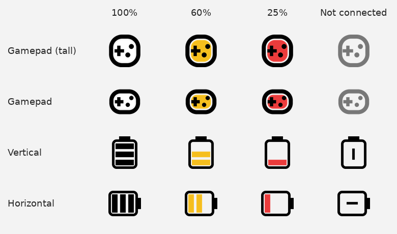

# Controller Battery Warning

A tiny Windows 11 tray app that shows your Bluetooth controller's battery level and warns you before it dies.

- **Tray icon** with the battery level: three bars (white, yellow at 2 bars, red at 1 bar)
- **Icon styles** from the right-click menu: Gamepad (tall) by default, or Vertical battery, Horizontal battery, Gamepad. The battery bars or the gamepad's fill turn yellow at 66% and red at 33%
- **Low battery notification** at 20% or lower, with the controller's name and percentage
- Checks every hour by default; change it from **Check every** in the right-click menu (5 min to 2 hours), or use **Check now**
- Runs hidden in the background and starts when you sign in
- **Xbox Mode On Start-Up** (optional): switches to Windows' Xbox mode after you log in, for desktop PCs that don't have Windows' own startup option
- No dependencies: plain PowerShell and built-in Windows components

## Icon styles

Pick a style from **Icon style** in the right-click menu. The icon follows your Windows light or dark theme.

<picture>
  <source media="(prefers-color-scheme: dark)" srcset="icons-dark.png">
  
</picture>

## Install

1. Download and extract the zip.
2. Double-click `Install-StartAtLogin.cmd`.

It copies everything to `%LOCALAPPDATA%\ControllerBatteryWarning`, adds a startup shortcut and a Start menu entry, and starts the app. You can delete the extracted folder afterwards.

If you close it, reopen it from the Start menu (search "Controller Battery").

## Xbox Mode On Start-Up

Windows only offers "Enter Xbox mode on startup" on gaming handhelds. Turn on **Xbox Mode On Start-Up** in the right-click menu and after you sign in the app waits for the Xbox app to start (Xbox mode needs it running; if it hasn't opened after about 30 seconds, the app opens it), then presses Windows' own Xbox mode shortcut (Win+F11), unless Xbox mode is already open. If Xbox mode still isn't open a few seconds later, you get a "Xbox Mode couldn't be opened" notification. Xbox mode must be turned on in **Settings > Gaming > Xbox mode** first.

## Uninstall

Right-click the tray icon and choose **Uninstall**, or run `Uninstall.cmd`.

## Which controllers work?

Any Bluetooth controller that reports its battery level to Windows. Quick check: if **Settings > Bluetooth & devices** shows a battery percentage for your controller, it will work.

- Xbox controllers: yes
- PlayStation and Switch controllers: usually not, since they don't report battery to Windows over standard Bluetooth

By default it looks for devices with "Xbox" in the name. For another controller, change `$NameMatch` at the top of `ControllerBatteryWarning.ps1` to part of its Bluetooth name.

## Settings

Edit the `param` block at the top of `ControllerBatteryWarning.ps1`:

| Setting | Default | What it does |
|---|---|---|
| `Threshold` | `20` | Battery % at or below which you get a notification |
| `CheckMinutes` | `60` | How often it checks (the **Check every** menu choice overrides this) |
| `NameMatch` | `Xbox` | Part of the controller's Bluetooth name |

To test, run in PowerShell:

```powershell
powershell -ExecutionPolicy Bypass -File .\ControllerBatteryWarning.ps1 -Test
```

## About `-ExecutionPolicy Bypass`

Windows blocks unsigned PowerShell scripts by default. The installer and shortcuts use `-ExecutionPolicy Bypass` so this one script can run without changing your system-wide policy. Feel free to read the script first; it reads Bluetooth battery info, shows the tray icon and notifications, and only writes to its own folder in `%LOCALAPPDATA%`.

## Files

- `ControllerBatteryWarning.ps1`: the app
- `Install-StartAtLogin.cmd`: installer
- `Uninstall.cmd`: uninstaller
- `gamepad_dark.ico`, `gamepad_light.ico`: Start menu icons for dark and light mode
- `images/`: icon previews for this README
